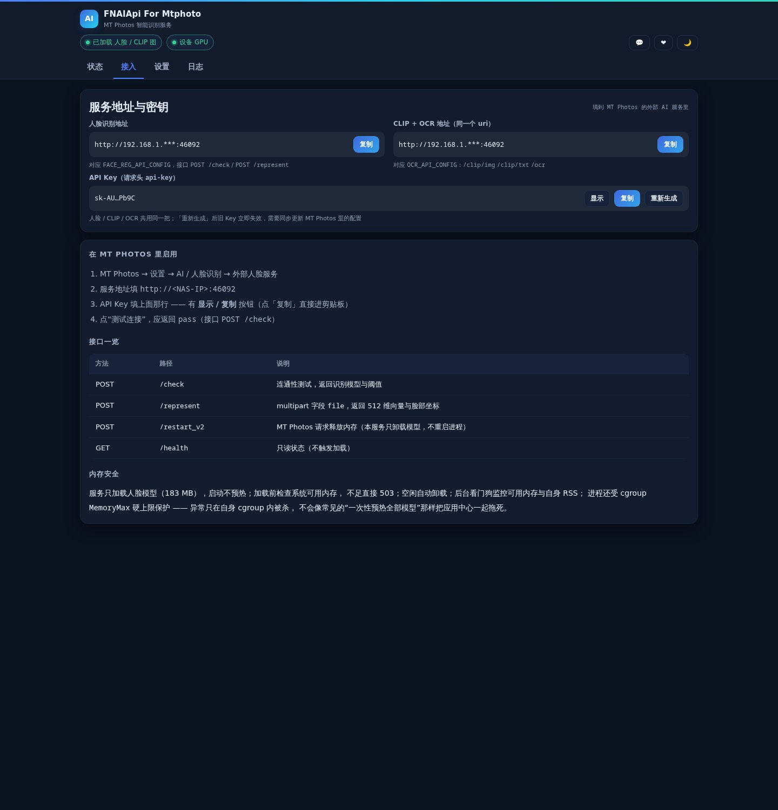
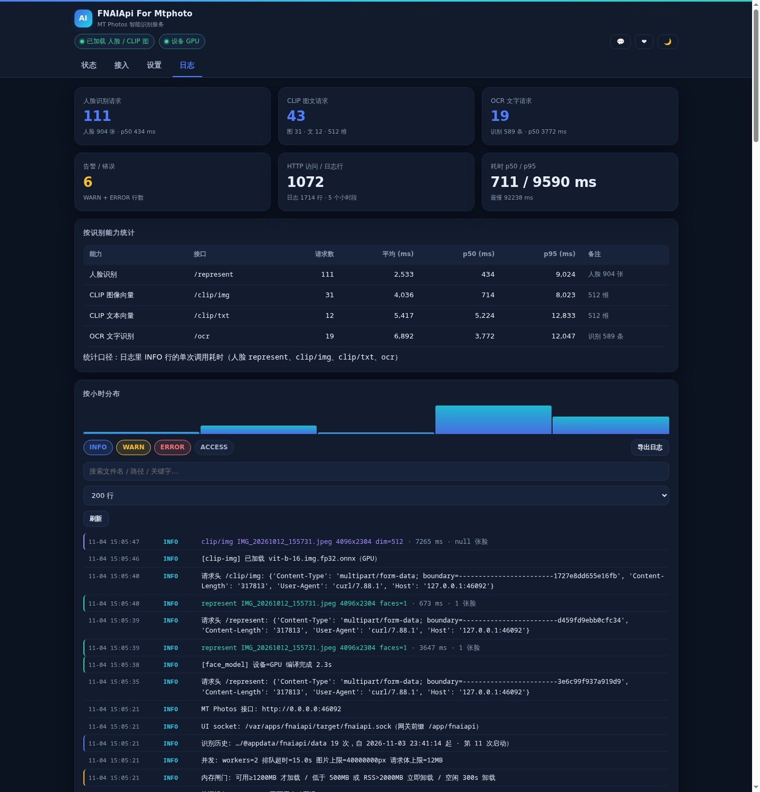

# 智能识别服务 · FNAIApi For Mtphoto

> MT Photos 照片库的本地 AI 引擎：人脸、以文搜图、文字识别三合一，全部在本机算完，照片不出门。

## 它做什么

装好之后，MT Photos 会多出三个能力：

- 👤 **人脸识别** —— 自动整理人物相册，照片里的每一张脸都能认得出来
- 🔍 **以文搜图** —— 输入一句话就能找照片，比如「海边的日落」「桌上的咖啡」
- 📝 **文字识别** —— 截图、单据、路牌上的字都能搜到

三个能力共用一套接口。在 MT Photos 里把「人脸识别」和「智能识别」的接口地址指向本应用即可，**不需要清空已有数据**：人脸和图片特征都是 512 维，与 MT Photos 现有格式一致，直接接上继续用。

## 为什么选它

同一台 NAS（2 核 CPU）上逐张实测，和常见的 mt-photos-ai 对比：

| 一张图要多久 | 本应用 | mt-photos-ai |
|---|---|---|
| 人脸识别 | **1.6 秒** | 43 秒 |
| 以文搜图的特征提取 | **0.7 秒** | 9.4 秒 |
| 文字识别 | **2.4 秒** | 18.5 秒 |

内存占用也更省：整轮跑下来峰值 1.5 GB，对方 2.5 GB；空闲时模型会自己卸掉，几乎不占内存，有人识别时才加载。

用的是 CPU 核显加速（OpenVINO），没有核显会自动退回纯 CPU，功能一样能用。

## 界面

<table>
<tr>
<td></td>
<td></td>
</tr>
<tr>
<td align="center">状态总览：就绪度、内存、耗时一目了然</td>
<td align="center">接入配置：填给 MT Photos 的地址与密钥</td>
</tr>
<tr>
<td></td>
<td></td>
</tr>
<tr>
<td align="center">设置：人脸 / 以文搜图 / 文字识别 分开调</td>
<td align="center">日志与识别历史：每次识别留痕，重启不清空</td>
</tr>
</table>

## 三步用起来

**第一步：安装**

应用中心 → 手动安装 → 选择 `fnaiapi.fpk`。装完桌面出现「智能识别服务」，点开就是管理界面。

**第二步：准备模型**

模型体积大，不随应用打包，需要准备一次（之后一直有效）。打开「设置」，三个子页里都有一键按钮：

- 如果本机装过 MT Photos 的 AI 容器，界面会给出复制命令，直接复用它的权重，不用重新下载
- 也可以从界面提供的下载源直接下载
- 或者把已有模型文件拷到模型目录，填路径导入

准备完成后首页会显示 `3/3 全部就绪`。

**第三步：接上 MT Photos**

在 MT Photos 网页端：

1. 【系统配置】→【人脸识别】→【API配置】：填接口地址和 `API_AUTH_KEY`
2. 【系统配置】→【智能识别】：填同样的地址和 Key（这一条同时管文字识别和以文搜图）

地址是 `http://你的NAS地址:46092`，Key 在本应用「接入」页可以一键复制。

## 用起来会遇到的几件事

**看到「模型未加载」不一定是故障。**
这是按需加载 —— 没有识别请求时模型不占内存，空闲 5 分钟自动卸载，下次有请求会自己加载回来（首次 1~6 秒）。鼠标悬停能看到当前加载了哪些模型、空闲多久。

**文字识别有 v4 和 v6 两档。**
v6 更快更准，推荐使用；如果你希望和 MT Photos 原来识别出的文字完全一致，可以切回 v4。

**能同时给几台设备用。**
它是标准 HTTP 服务，局域网内其他机器把地址换成这台 NAS 的 IP 就行。

**卸载会保留配置。**
你的设置和识别历史在应用数据目录里，卸载时向导会让你选留还是清，重装后可以继续用。

## 更新说明

### v0.1.0 · 首次发布

- 人脸识别、以文搜图、文字识别三个能力，一个应用全部提供
- 与 MT Photos 现有数据格式兼容，切换过来无需重新识别
- 支持核显加速，无核显自动回退 CPU；模型按需加载、空闲自动释放，内存占用可控
- 识别历史保存在本地，重启不丢，可按能力筛选、按天查看
- 模型准备不用敲命令：一键复制、多源下载、本地导入三种方式都支持
- 管理界面支持深色 / 浅色主题与手机访问

## 反馈

- QQ 群：**745565752**（应用内 💬 按钮可直接复制群号）
- 项目主页：<https://gitee.com/wyf1015/fnaiapi>
- 如果它帮到了你，应用内 ❤ 按钮可以请作者喝杯咖啡

---

*本应用需要配合 MT Photos 使用；MT Photos 本身是独立产品，与本应用无隶属关系。*
