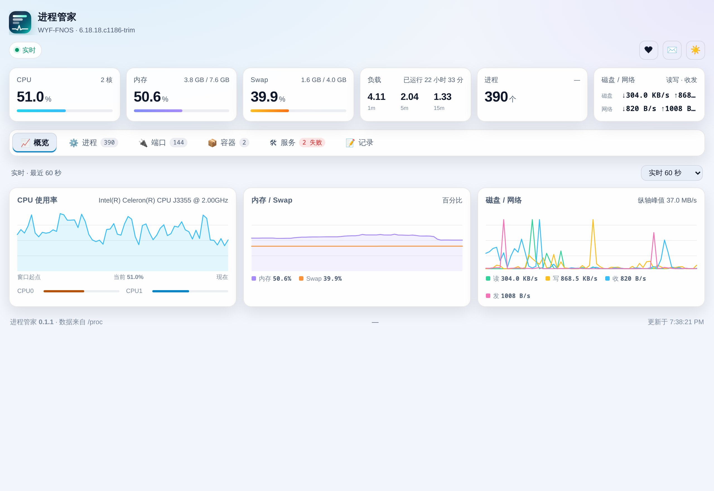
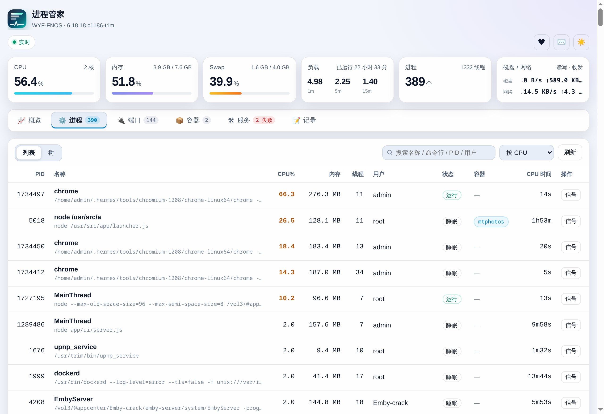
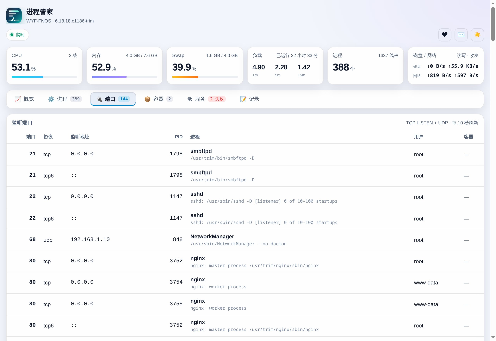
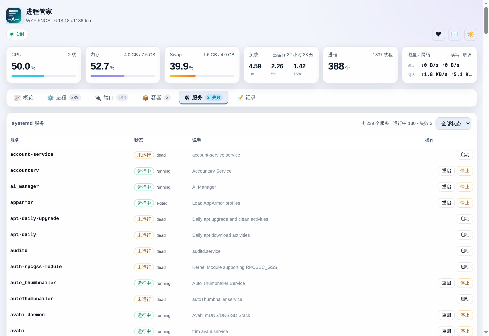

# 进程管家 (fnproc)

> 机器为什么变慢、8080 被谁占了、哪个服务又挂了 —— 打开一个页面全看清，还能直接处置。

进程管家是给飞牛 fnOS 做的**进程与系统资源管理器**：把平时要 SSH 上去敲 `top`、`ss`、`systemctl` 才能看到的东西，做成一个打开就能用的网页。看到问题，点两下就能处理，每一步都会留下记录。

---

## 它解决哪些麻烦

- **机器突然变慢**，不知道是哪个进程在吃 CPU 或内存
- **装应用提示端口被占**，却查不到是哪个程序占着
- **某个服务悄悄挂了**，得连 SSH 敲命令才知道
- **想停掉一个卡死的进程**，还要确认 PID、记着信号名
- **出问题想复盘**：「刚才谁重启过服务？」日志里翻半天也找不到

这四件事在进程管家里都是一两下点击的事，而且都会记进操作记录，随时能查。

---

## 功能一览

七个页面，顶部关键指标条始终可见。

### 📈 概览 —— 一眼看清整机状态

- 六项关键指标：CPU、内存、Swap、负载、进程数、磁盘读写与网络收发
- 三张趋势曲线：CPU、内存 + Swap、磁盘 + 网络
- 时间范围随手切：最近 60 秒 / 10 分钟 / 1 小时 / 6 小时 / 24 小时
- 历史数据自动留存约 25 小时，重启应用也不清空

### ⚙️ 进程 —— 谁在吃资源

- **列表**：按 CPU / 内存 / PID 排序，输入关键字即时筛选
- **树形**：按父子关系展开，父进程直接显示整棵子树的 CPU 与内存合计，一眼看出「这个服务全家吃了多少」
- **详情**：命令行、所在目录、运行用户、线程数、打开的文件数、启动时间、磁盘读写、子进程
- **处置**：支持 9 种信号（结束、暂停、继续、重载等），点一下就能发

### 🔌 端口 —— 端口到底被谁占了

列出所有监听中的端口，并把每个端口对应到具体的进程、用户和容器。装应用撞端口时，来这里看一眼就知道该找谁。

### 📦 容器 —— Docker 里在跑什么

按容器聚合进程数、CPU、内存、线程数，点一下只看某个容器里的进程。

### 🛠 服务 —— 系统服务直接启停

列出全部 systemd 服务，运行中、未运行、失败一目了然，失败项标红。可以就地启动、停止、重启 —— 不用再开终端。

关键系统服务（SSH、网络、systemd 自身、定时任务等）的停止与重启按钮会置灰，只允许「启动」—— 防止手滑把自己锁在门外。

### 🔔 告警 —— 出事第一时间知道

- 可对 CPU / 内存 / Swap / 磁盘 / 内存压力 / 进程消失 / 服务 failed / OOM 设置规则
- **持续超标才提醒**（比如持续 3 分钟才算），提醒后进入冷却，不会刷屏
- 通知直接落到飞牛桌面通知（铃铛），也可以再填一个 Webhook 转发到别处
- 新建规则时可一键套用六个常用模板，不用自己填阈值和方向
- 每条提醒的投递结果（成功 / 失败原因）都记在事件表里，出问题能查

### 📝 记录 —— 每一步都有账可查

发信号、启停服务、应用自身启动停止，以及**被拒绝的尝试**，全部记下来，可追溯：

- 按操作类型、结果（成功 / 拒绝 / 失败）筛选，或直接搜关键字
- 顶部汇总显示总条数与结果分布
- 记录写在本地数据库里，**重启、崩溃、断电都不会丢**，也不会被自动清理

---

## 界面预览

| 概览 | 进程 |
|---|---|
|  |  |

| 端口 | 服务 |
|---|---|
|  |  |

---

## 关于安全与克制

- **不联网**：应用不连接任何外部服务，不采集、不上传任何数据
- **只看本机**：读的是系统自带的进程与资源信息，不碰你的照片、文档、影音文件
- **零额外依赖**：除应用本身，不会往你的 NAS 上装任何东西
- **危险操作有护栏**：
  - 系统 1 号进程与进程管家自己，不允许结束
  - 关键系统服务只允许启动，不允许停止或重启
  - 所有结束进程、启停服务的操作都需要二次确认
  - 每一次尝试（包括被拦下的）都会写进操作记录

---

## 快速上手

1. 安装后打开**进程管家**
2. 首页「概览」就能看到整机 CPU、内存与趋势曲线
3. 机器卡顿时切到「进程」，按 CPU 排序，点那一行看详情，需要时发信号处理
4. 装应用提示端口占用时，切到「端口」搜端口号，直接看到是哪个进程
5. 想确认刚才做了什么，切到「记录」即可

---

## 数据存在哪

| 内容 | 位置 | 说明 |
|---|---|---|
| 操作记录 | 应用数据目录 `data/audit.db` | 只增不删，重启不丢 |
| 历史曲线 | 应用数据目录 `data/history.jsonl` | 约保留 25 小时，超出自动滚动 |
| 运行日志 | 应用数据目录 `info.log` | 启动与异常记录 |

这些文件都在应用自己的数据目录里，卸载应用时如果选择保留数据，记录会一起留着。全部数据只在本机，不涉及云同步。

---

## 常见问题

**问：图表一直是空的？**
答：曲线需要累计几秒数据才会画出来，打开后稍等 2～3 秒。若是长时间空白，先确认应用是「运行中」，再刷新页面。

**问：为什么有些进程的端口看不到？**
答：容器内的进程使用自己的网络空间，它的端口不会出现在主机侧，这是系统隔离的正常结果。

**问：为什么关键服务的停止按钮是灰的？**
答：这些服务一旦停掉，NAS 可能失联或系统异常，因此只开放「启动」。

**问：记录会不会越攒越多、把盘撑满？**
答：单条记录很小（几百字节），日常操作一天也就几十条。记录按你的要求不会自动删除，长期运行也只占几 MB。

**问：会拖慢 NAS 吗？**
答：采样每秒一次且只读系统信息，常驻内存占用很小，正常使用几乎察觉不到。

---

## 系统要求

- 飞牛 fnOS（任意平台）
- CPU 架构：不挑（x86_64 / ARM64 均可）
- 依赖的 Node.js 运行时会由应用中心自动装好

---

## 更新记录

### v0.2.0

首发之后的一个大版本。进程管家从「看得见」变成「管得动」。

**新增**

- **告警页**：八类判据、持续超标才提醒、提醒后冷却不刷屏，通知落到飞牛桌面通知，也可填 Webhook
- **服务日志**：服务行可直接看 `journalctl` 日志并过滤，还能改开机自启、看定时器与 crontab
- **进程快照与对比**：记录当时进程清单，对比两个时刻之间新起了谁、谁没了、谁内存涨得最多；支持每天自动快照
- **进程追踪**：盯某个关键字，新进程冒出来就记一条，只观察不执行命令
- **看门狗**：监视的进程不在了就执行命令拉回来，默认不启用
- **诊断包**：日志、快照、端口、曲线、告警、操作记录打成一个 `tar.gz`，报障直接丢文件
- **按用户聚合**、**磁盘 IO 排行**、**关注的服务**、**审计重放**（仅服务启停）

**更好用**

- **批量处置**：勾选多个进程一次发信号，上限 50 个
- **结束整棵子树**：node / python 这类带一堆 worker 的服务一次结束，先子后父
- **进程详情**补 PSS / 独享 / 共享内存三个口径，以及线程、父进程链、控制组、OOM 调整值
- **历史曲线最长 7 天**，跨度越长自动按更粗粒度聚合
- **操作记录持久保存**：重启、崩溃、断电都不丢，可按操作与结果筛选、搜索、分页
- **区块可折叠（整套统一）**：服务、定时器、crontab、开机耗时、告警规则、告警事件、看门狗、进程追踪都能点标题收起，查看类默认展开、配置类默认收起，并记住你的选择
- **手机端自适应**：只有进程表和端口表保留横向滚动，其余表格在手机上都撑满屏幕直接可读
- **主题三态**：亮色 / 暗色 / 跟随系统
- **安全加固**：写操作强制 JSON 并拒绝跨站来源、静态资源白名单、Webhook 拦截内网地址、关键服务保护覆盖 fnOS 平台服务
- **性能**：接口压缩后进程列表 100 KB → 15 KB、实时帧 16 KB → 1.8 KB、空闲 CPU 3.1% → 0.8%、读系统调用减少 20.3%

**修正**

- 告警规则编辑不再丢失「小于」判据；进程详情切换行不再「看到 A、操作的是 B」
- 导出 CSV 与页面筛选一致，修复末尾截断，并对 `=` `+` `-` `@` 开头的单元格做公式注入防护
- 快照对比显示内存变化正负号，删除快照不再删错对象、失败不谎报成功
- 输入框可以正常输入 `/`；所有请求 20 秒超时；弹窗支持 ESC 关闭
- 卸载流程可保留或删除数据、可清理本应用产生的桌面通知，支持演练模式

### v0.1.0（2026-11-07）首发

- 六个页面：概览、进程、端口、容器、服务、记录，顶部指标条始终可见
- 进程：列表 / 树形 / 详情三种视角，支持 9 种信号处置
- 端口：监听端口精确归属到进程、用户与容器
- 容器：Docker 容器聚合，可只看某个容器的进程
- 服务：系统服务就地启停，关键服务受保护
- 概览曲线支持 60 秒到 24 小时六档时间范围，历史数据自动留存
- 亮色 / 暗色主题一键切换，桌面与手机自适应

---

## 反馈与支持

- **QQ 群**：745565752（应用内「✉️ 反馈」按钮可一键复制群号）
- **项目主页**：<https://github.com/Wyf841015>
- 提问题时建议带上：应用版本号（页脚）、复现步骤、相关进程的 PID 或命令行

如果进程管家帮你省下了时间，欢迎在应用内点「❤ 赞助」请作者喝杯咖啡 —— 完全自愿，不影响任何功能。
